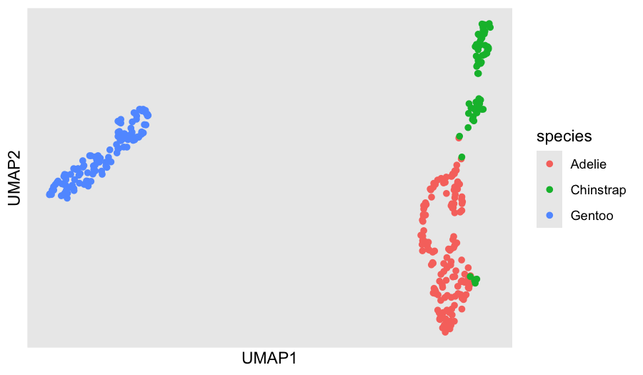

<!-- README.md is generated from README.Rmd. Please edit that file -->

# ggumap

<!-- badges: start -->

[](https://github.com/jeroenjanssens/ggumap/actions/workflows/R-CMD-check.yaml)
[](https://app.codecov.io/gh/jeroenjanssens/ggumap)
[](https://extendr.rs/extendr/extendr_api/)
<!-- badges: end -->

ggumap adds UMAP to ggplot2. `geom_umap()` and `stat_umap()` compute a
[UMAP](https://umap-learn.readthedocs.io/) embedding of the layer data
and draw it, in a single step:

``` r
library(ggplot2)
library(ggumap)

ggplot(palmerpenguins::penguins, aes(colour = species)) +
  geom_umap(features = bill_length_mm:body_mass_g, scale = TRUE, na.rm = TRUE) +
  theme_umap()
```



- **Tidy feature selection.** Choose the input columns with `features`,
  using `dplyr::select()` syntax. All numeric columns are used by
  default.
- **Points, text, labels.** `geom_umap()` draws points, and
  `stat_umap(geom = "text")` or `"label"` annotate them. Aesthetics are
  carried along row by row and never split the embedding.
- **Fast.** The computation is done by Apple’s multi-threaded Rust port
  of umap-learn and PyNNDescent, from
  [embedding-atlas](https://github.com/apple/embedding-atlas).
- **Stable plots.** Seeds are derived from the data, and results are
  cached: re-drawing, resizing or saving a plot does not move the points
  or recompute the embedding, and several layers share one embedding.
- **Facets.** One embedding for the whole layer (default) or one per
  panel.
- **Interruptible**, with a progress bar for long computations.

## Installation

ggumap needs a Rust toolchain (rustc \>= 1.90) to build from source; see
<https://rust-lang.org/tools/install/>.

``` r
# install.packages("pak")
pak::pak("jeroenjanssens/ggumap")
```

## Usage

``` r
cars <- transform(mtcars, model = rownames(mtcars))

ggplot(cars, aes(label = model, colour = factor(cyl))) +
  geom_umap(scale = TRUE, n_neighbors = 5) +
  stat_umap(geom = "text", scale = TRUE, n_neighbors = 5,
            size = 2.5, vjust = -0.8, show.legend = FALSE,
            check_overlap = TRUE) +
  scale_x_continuous(expand = expansion(mult = 0.15)) +
  labs(colour = "cylinders") +
  theme_umap()
```


`umap_embed()` gives you the embedding as a data frame, outside of a
plot:

``` r
umap_embed(iris, Sepal.Length:Petal.Width, seed = 1) |> head()
#>      UMAP1     UMAP2  knn_dist
#> 1 12.89850  9.066114 0.2206497
#> 2 15.01168  8.909729 0.2788145
#> 3 14.62423  8.497745 0.2883166
#> 4 14.85246  8.678940 0.2761466
#> 5 12.91833  8.970540 0.2452016
#> 6 12.09575 10.244448 0.4382381
```

See `vignette("ggumap")` for more.

## Acknowledgements

The UMAP and nearest neighbour implementations are © Apple Inc. (MIT
licence), ported from [umap-learn](https://github.com/lmcinnes/umap) and
[PyNNDescent](https://github.com/lmcinnes/pynndescent) by Leland
McInnes.
