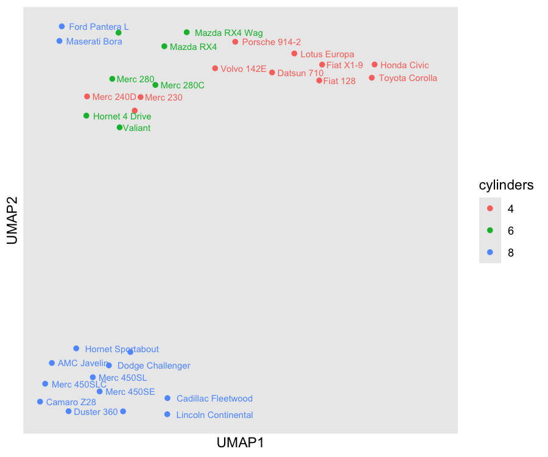

<!-- README.md is generated from README.Rmd. Please edit that file -->

# ggumap

<!-- badges: start -->

[](https://github.com/jeroenjanssens/ggumap/actions/workflows/R-CMD-check.yaml)
[](https://app.codecov.io/gh/jeroenjanssens/ggumap)
[](https://extendr.rs/extendr/extendr_api/)
<!-- badges: end -->

ggumap adds UMAP to ggplot2. `geom_umap()` and `stat_umap()` compute a
[UMAP](https://umap-learn.readthedocs.io/) embedding of the layer data
and draw it, in a single step:

``` r
library(ggplot2)
library(ggumap)

ggplot(palmerpenguins::penguins, aes(colour = species)) +
  geom_umap(features = bill_length_mm:body_mass_g, scale = TRUE, na.rm = TRUE) +
  theme_umap()
```


- **Tidy feature selection.** Choose the input columns with `features`,
  using `dplyr::select()` syntax. All numeric columns are used by
  default.
- **Points, text, labels.** `geom_umap()` draws points, and
  `stat_umap(geom = "text")` or `"label"` annotate them. Aesthetics are
  carried along row by row and never split the embedding.
- **Fast.** The computation is done by Apple’s multi-threaded Rust port
  of umap-learn and PyNNDescent, from
  [embedding-atlas](https://github.com/apple/embedding-atlas).
- **Stable plots.** Seeds are derived from the data, and results are
  cached: re-drawing, resizing or saving a plot does not move the points
  or recompute the embedding, and several layers share one embedding.
- **Facets.** One embedding for the whole layer (default) or one per
  panel.
- **Interruptible**, with a progress bar for long computations.

## Installation

ggumap needs a Rust toolchain (rustc \>= 1.90) to build from source; see
<https://rust-lang.org/tools/install/>.

``` r
# install.packages("pak")
pak::pak("jeroenjanssens/ggumap")
```

## Usage

``` r
cars <- transform(mtcars, model = rownames(mtcars))

ggplot(cars, aes(label = model, colour = factor(cyl))) +
  geom_umap(scale = TRUE, n_neighbors = 5, min_dist = 1) +
  stat_umap(geom = "text", scale = TRUE, n_neighbors = 5, min_dist = 1,
            size = 2.5, hjust = -0.12, show.legend = FALSE,
            check_overlap = TRUE) +
  scale_x_continuous(expand = expansion(mult = c(0.05, 0.25))) +
  labs(colour = "cylinders") +
  theme_umap()
```



`umap_embed()` gives you the embedding as a data frame, outside of a
plot:

``` r
penguins <- na.omit(palmerpenguins::penguins)
umap_embed(penguins, bill_length_mm:body_mass_g, scale = TRUE, seed = 1) |> head()
#>      UMAP1    UMAP2  knn_dist
#> 1 8.951698 7.911100 0.4842742
#> 2 8.656451 8.798175 0.4916678
#> 3 8.313984 9.207904 0.5714622
#> 4 8.232854 7.165707 0.5629448
#> 5 8.972029 5.958261 0.6880632
#> 6 8.726288 8.545345 0.4997849
```

See `vignette("ggumap")` for more.

## Performance

ggumap is much faster than the
[umap](https://cran.r-project.org/package=umap) package, and on par with
[uwot](https://cran.r-project.org/package=uwot):


| Implementation    | Seconds | Trustworthiness |
|:------------------|--------:|----------------:|
| ggumap, 8 threads |     1.2 |           0.956 |
| uwot, 8 threads   |     1.4 |           0.955 |
| uwot, 1 thread    |     5.3 |           0.956 |
| ggumap, 1 thread  |     5.6 |           0.956 |
| umap (pure R)     |    54.1 |           0.956 |

20,000 observations, median of 3 runs.

All three find embeddings of the same quality (trustworthiness measures
how well the embedding preserves the nearest neighbours of the input).
With one thread, uwot is somewhat faster than ggumap’s default
`flavour = "0.5"`; the `flavour = "0.6"` pipeline was two to three times
as fast as the default at 10,000 observations. See
[`bench/`](https://github.com/jeroenjanssens/ggumap/tree/main/bench) for
the methodology, and run `just bench-readme` to reproduce the figure on
your machine.

## Acknowledgements

The UMAP and nearest neighbour implementations are © Apple Inc. (MIT
licence), ported from [umap-learn](https://github.com/lmcinnes/umap) and
[PyNNDescent](https://github.com/lmcinnes/pynndescent) by Leland
McInnes.
